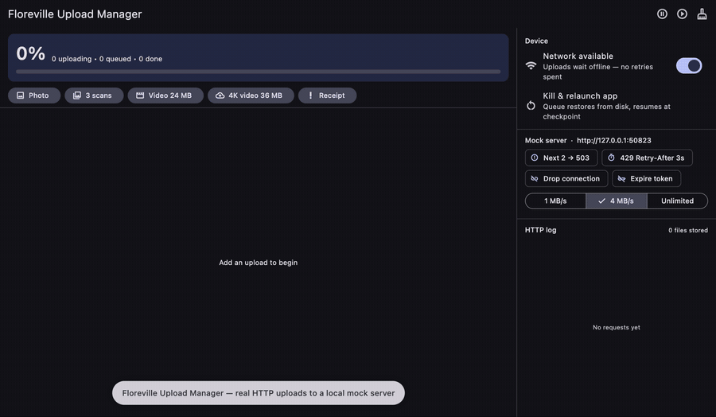

# floreville_upload_manager

[](https://pub.dev/packages/floreville_upload_manager)
[](LICENSE)


**Uploads that survive real life.** A persistent, offline-tolerant upload queue
for Flutter: it keeps going through flaky networks, server errors, expired
tokens and app kills, and resumes big files from the last confirmed chunk
instead of starting again from 0 %.



<sub>The [example app](example/) running against the bundled mock server.
Every request in the log is real HTTP. [Full-length video (MP4)](doc/media/demo.mp4).</sub>

---

## Why

`http.post(file)` works on the office Wi-Fi. In the field, users walk into
lifts, switch apps, lose signal halfway through a 200 MB video and get
logged out while a queue is waiting. This package handles that for you:

| | |
|---|---|
| 🔁 **Smart retries** | Exponential backoff with jitter. Honours `Retry-After`. Retries only what's worth retrying (timeouts, 408/429/5xx), never a 400. |
| 📶 **Offline-aware** | Losing the network pauses the queue *without* spending retries; it resumes by itself when the network comes back. |
| 💾 **Survives app kills** | The queue is persisted atomically. Kill the app mid-upload and the next launch picks up where it left off. |
| ⏯️ **Resumable** | `Content-Range` chunking and **S3 multipart** checkpoint after every confirmed chunk/part, so pause, crash and resume continue from there. |
| ☁️ **S3, R2, MinIO, GCS…** | Multipart uploads straight to the bucket through presigned part URLs. Credentials never touch the device. A Supabase Edge Function signer is included. |
| 🔑 **Fresh auth, no secrets on disk** | A `headerProvider` runs before every attempt, a `401` is refreshed and retried, and `Authorization`/cookies/API keys are never written to the queue file. |
| 🚦 **Priorities & concurrency** | `critical` › `high` › `normal` › `low`, with a configurable number of parallel uploads. |
| 📊 **Progress everywhere** | Per-task speed and ETA, aggregate queue progress, streams, callbacks, one grouped notification, and drop-in widgets. |
| 🧪 **Testable offline** | Ships `MockUploadServer`, a real local HTTP backend for every protocol with injectable faults, for your own tests and demos. |

## Platform support

| Android | iOS | macOS | Linux | Windows | Web |
|:---:|:---:|:---:|:---:|:---:|:---:|
| ✅ | ✅ | ✅ | ✅ | ✅ | ❌ (`dart:io`) |

Progress notifications use `flutter_local_notifications` on Android, iOS and
macOS.

---

## Install

```bash
flutter pub add floreville_upload_manager
```

### Platform setup

**Android:** `android/app/src/main/AndroidManifest.xml`

```xml
<uses-permission android:name="android.permission.INTERNET" />
<uses-permission android:name="android.permission.ACCESS_NETWORK_STATE" />
<uses-permission android:name="android.permission.POST_NOTIFICATIONS" />
```

`flutter_local_notifications` also needs core library desugaring enabled in
`android/app/build.gradle(.kts)`. Follow
[its README](https://pub.dev/packages/flutter_local_notifications) for your
version.

**iOS:** set `platform :ios, '14.0'` in `ios/Podfile`. In `AppDelegate.swift`,
inside `application(_:didFinishLaunchingWithOptions:)`:

```swift
if #available(iOS 10.0, *) {
  UNUserNotificationCenter.current().delegate = self as? UNUserNotificationCenterDelegate
}
```

**macOS:** enable *Outgoing Connections (Client)* in both entitlements files.

---

## Quick start

```dart
import 'package:floreville_upload_manager/floreville_upload_manager.dart';

Future<void> main() async {
  WidgetsFlutterBinding.ensureInitialized();

  await FlorevilleUploadManager.initialize(
    maxConcurrentUploads: 2,
    retryPolicy: const RetryPolicy(maxRetries: 5),
    // Runs before EVERY attempt, so tokens are always fresh, even for tasks
    // restored after an app restart. A 401 is retried with a new token.
    headerProvider: (task) async {
      final token = await myAuth.currentAccessToken();
      return {'Authorization': 'Bearer $token'};
    },
  );

  runApp(const MyApp());
}
```

```dart
final task = await FlorevilleUploadManager.upload(
  file: pickedFile.path,                 // a File or a String path
  url: 'https://api.example.com/uploads',
  data: {'albumId': '42'},               // extra multipart fields
  priority: TaskPriority.high,
  onProgress: (progress, speed, eta) => debugPrint('${(progress * 100).round()}%'),
  onSuccess: (t) => debugPrint('Done: ${t.response}'),
  onError: (t, e) => debugPrint('Failed: ${t.error}'),
);

// or, with the File extension:
await File(path).upload(url: 'https://api.example.com/uploads');
```

`upload` returns as soon as the task is **persisted**. The transfer starts
when a slot and the network are available, and continues across restarts.

Ask for notification permission at a sensible moment (Android 13+, iOS):

```dart
await FlorevilleUploadManager.instance.requestNotificationPermission();
```

### Show it in your UI

```dart
StreamBuilder<QueueSummary>(
  stream: engine.summaryStream,          // fires on every queue change
  initialData: engine.summary,
  builder: (context, _) => ListView(
    children: [
      for (final task in engine.tasks)
        UploadTaskTile(key: ValueKey(task.id), task: task),
    ],
  ),
);
```

`UploadTaskTile` shows the file, live progress, speed and ETA, with
pause/resume/retry/remove controls. `UploadProgressBar(taskId: id)` is the
minimal version.

---

## Upload styles

### Several files in one request

```dart
await FlorevilleUploadManager.uploadMultiple(
  files: [a.path, b.path, c.path],
  url: 'https://api.example.com/uploads/bundle',
  fileFieldName: 'files',
);
```

A bundle succeeds or retries as a unit. For independent files, call `upload`
once per file.

### Presigned PUT (S3, R2, GCS, Supabase signed upload URLs)

A single-file `PUT` sends a **raw body** (no multipart wrapper):

```dart
await FlorevilleUploadManager.upload(
  file: path,
  url: presignedPutUrl,
  method: 'PUT',
  metadata: {'contentType': 'video/mp4'}, // must match what you signed
);
```

Force a mode with `metadata: {'bodyMode': 'raw' | 'multipart'}`.

> Presigned URLs expire. If a task may wait in the queue longer than the URL
> lives, use the resumable or S3 multipart protocol, which sign on demand.

## Protocols

| Protocol | Use it for | Resumes from checkpoint |
|---|---|:---:|
| `UploadProtocol.standard` *(default)* | Normal REST endpoints; files up to tens of MB | restarts at 0 |
| `UploadProtocol.resumable` | Servers that accept `Content-Range` chunks | ✅ last accepted chunk |
| `UploadProtocol.s3Multipart` | Large files to S3 / R2 / MinIO / Wasabi / Spaces | ✅ last accepted part |
| `UploadProtocol.simulated` | UI work and demos without a backend | ✅ |
| `UploadProtocol.custom` | Your own `UploadAdapter` | adapter-defined |

### Resumable (`Content-Range`)

```dart
await FlorevilleUploadManager.upload(
  file: path,
  url: 'https://api.example.com/uploads/$uploadId',
  method: 'PUT',
  protocol: UploadProtocol.resumable,
);
```

Each chunk is sent as `Content-Range: bytes START-END/TOTAL` and is accepted
on 2xx, or on `308` for non-final chunks. A `Range: bytes=0-N` (or
`Upload-Offset`) response header is taken as the confirmed offset, so a
server that kept more or less than expected is handled correctly. The offset
is checkpointed after every chunk together with the file's size and mtime;
if the file changed, the upload restarts cleanly.

Tune it by registering your own instance (the same id replaces the default):

```dart
await FlorevilleUploadManager.initialize(adapters: [
  ResumableUploadAdapter(
    chunkSize: 4 * 1024 * 1024,
    offsetProbe: ResumableUploadAdapter.contentRangeProbe, // GCS-style status query
  ),
]);
```

### S3 multipart (presigned parts)

Your backend implements four small endpoints and the app uploads parts
straight to the bucket:

```dart
await FlorevilleUploadManager.initialize(
  headerProvider: (_) async => {'Authorization': 'Bearer ${await token()}'},
  adapters: [
    S3MultipartUploadAdapter(
      signer: HttpS3MultipartSigner(
        baseUrl: 'https://<project>.supabase.co/functions/v1/s3-multipart',
      ),
      partSize: 8 * 1024 * 1024,
    ),
  ],
);

await FlorevilleUploadManager.upload(
  file: videoPath,
  url: 's3',                            // unused by this adapter
  protocol: UploadProtocol.s3Multipart,
  metadata: {'contentType': 'video/mp4'},
);
```

The flow is `initiate` → for each part `sign-part` + `PUT` (ETag
checkpointed) → `complete`. Cancelling calls `abort`. A `403` on a part
(an expired URL) is retried with a fresh signature. `task.headers` go to
your signer, never to S3.

The JSON contract and a complete **Supabase Edge Function** (with per-user key
ownership checks) are in [`doc/s3_signer_backend.md`](doc/s3_signer_backend.md).
For anything else (a Next.js route, Firebase or Cloud Function), implement
`S3MultipartSigner` yourself.

### Custom adapter

```dart
class MyApiAdapter extends UploadAdapter {
  @override
  String get id => 'my_api';

  @override
  Future<UploadResponse> upload(UploadContext ctx) async {
    // Use ctx.task, ctx.cancelToken, ctx.reportProgress(sent, total), and
    // ctx.resumeState + ctx.checkpoint({...}) for resumability.
    // Throw UploadException(retryable: true/false, statusCode: …) on failure.
  }
}

FlorevilleUploadManager.instance.registerAdapter(MyApiAdapter());
await FlorevilleUploadManager.upload(
  file: path, url: '...', protocol: UploadProtocol.custom, customAdapterId: 'my_api');
```

---

## Queue control & observing

```dart
final engine = FlorevilleUploadManager.instance;

engine.pause(id);  engine.resume(id);  engine.retry(id);
engine.cancel(id); engine.deleteTask(id);
engine.pauseAll(); engine.resumeAll(); engine.cancelAll();
engine.retryAllFailed(); engine.clearFinished();

engine.tasks;                 // display-ordered list
engine.tasksWithTag('photos');
engine.summary;               // QueueSummary snapshot
engine.watch(id);             // Stream<UploadTask> for one task
engine.statusStream;          // lifecycle changes, all tasks
engine.progressStream;        // byte progress, all tasks
engine.summaryStream;         // every queue change (progress throttled to 4 Hz)
```

Per-task callbacks (`onProgress`, `onSuccess`, `onError`) live in memory
only. After an app restart, react to `statusStream` instead, e.g. update your
database row when a task with a given `metadata['recordId']` completes.

| Status | Meaning |
|---|---|
| `enqueued` | Waiting for a slot, the network, or a retry backoff (`isWaitingForRetry`) |
| `running` | Transferring |
| `paused` | Paused by the user; never resumed automatically |
| `failed` | Non-retryable error or retries exhausted; `resume`/`retry` to try again |
| `completed` / `cancelled` | Terminal; remove with `clearFinished()` |

## Retries

`RetryPolicy()` defaults to 5 retries, 2 s → ×2 → capped at 5 min, ±20 %
jitter.

* **Retried:** timeouts, connection errors, 408/425/429/5xx (except 501), and
  401 when a `headerProvider` can refresh the token.
* **Not retried:** other 4xx, missing files, bad certificates, cancellation.
* `Retry-After` (seconds or HTTP date) is honoured, capped at `maxDelay`.
* Going offline never uses up a retry.
* Override per task with `maxRetries:`, or globally with
  `RetryPolicy(shouldRetryOverride: (error, attempt) => …)` (return `null` to
  fall back to the defaults).

---

## Testing your app: `MockUploadServer`

The package ships a real HTTP server for tests and demos. It runs on
loopback, speaks every protocol above, and lets you inject failures:

```dart
import 'package:floreville_upload_manager/testing.dart';

final server = await MockUploadServer.start();

server.failNext(2, status: 503);                       // two server errors
server.failNext(1, status: 429, retryAfter: const Duration(seconds: 3));
server.dropNextConnection(afterBytes: 256 * 1024);     // connection reset mid-body
server.requireAuth = true; server.rotateToken();       // expired token → 401
server.presignTtl = const Duration(seconds: -1);       // expired S3 part URLs → 403
server.throttleBytesPerSecond = 1024 * 1024;           // slow network

await engine.enqueue(filePaths: [path], url: server.url('/upload'));
// …
expect(server.objects.single.bytes, await File(path).readAsBytes());
await server.close();
```

| Endpoint | Protocol |
|---|---|
| `POST /upload` | multipart/form-data |
| `PUT /objects/<name>` | raw body (presigned-PUT style) |
| `PUT /resumable/<id>` | `Content-Range` chunks |
| `POST /s3/{initiate,sign-part,complete,abort}` + `PUT /bucket/…` | S3 multipart signer + bucket |

`UploadEngine` also takes injectable storage, connectivity and adapters:
`InMemoryQueueStorage`, `ManualConnectivityMonitor`, `SimulatedUploadAdapter`
and `NotificationConfig.disabled` keep engine tests fast and deterministic.

### How this package is tested

* **Unit tests** for the engine, queue, retry policy, storage and each adapter.
* **End-to-end tests** (`test/e2e_mock_server_test.dart`) run the real
  engine, Dio and on-disk queue against `MockUploadServer`, covering
  byte-for-byte delivery, 503/429 backoff, dropped connections, 401 refresh,
  secrets never reaching disk, pause/resume, app-kill recovery, offline
  handling, S3 re-signing and abort, priorities and concurrency.
* **An integration test** (`example/integration_test/`) drives the example
  app through every feature on a real device or desktop, and verifies every
  byte the server received.

```bash
flutter test                                              # unit + end-to-end
cd example && flutter test integration_test -d macos      # UI tour
```

## Example app

[`example/`](example/) is the app in the video. It embeds `MockUploadServer`,
generates real files, and has buttons for every upload style plus fault
injection (503s, `Retry-After`, dropped connections, an expiring token,
throttling, network loss and *Kill & relaunch*), with a live HTTP log.

```bash
cd example
flutter create . --platforms=macos   # or android, ios, linux, windows
flutter run
```

---

## Security notes

* **Secrets are not written to disk.** `Authorization`, `Cookie`, `apikey`,
  `x-api-key`, `x-amz-security-token`, … are stripped from the persisted
  queue (`kSensitiveHeaders`; configurable with
  `FileQueueStorage(redactedHeaders: …)`). Supply auth through
  `headerProvider` so restored tasks get fresh tokens.
* The queue file lives in the app-support directory, which isn't user-visible.
* Server responses are persisted with tasks by default. If they can contain
  personal data (POPIA/GDPR), use `FileQueueStorage(persistResponses: false)`.
* S3: keep bucket credentials on the server. The signer must check that the
  caller owns the object key on every call; the reference function does.

## Limitations

* **Background execution:** uploads run while the app process is alive. iOS
  suspends a backgrounded app within about 30 s, and Android may kill it under
  memory pressure. The queue persists, so interrupted uploads continue on the
  next launch (from the last checkpoint for resumable and S3). OS-managed
  background transfers (iOS background `URLSession`, Android WorkManager) are
  not included.
* Chunks and parts of one file upload sequentially; concurrency is across
  tasks (`maxConcurrentUploads`).
* `standard` uploads restart from 0 after an interruption. Use `resumable` or
  `s3Multipart` for large files.

## License

MIT. See [LICENSE](LICENSE).
